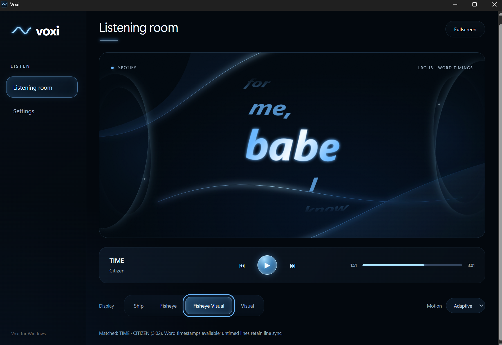

# Voxi

**Lyrics, reimagined.** An open-source Windows music companion that brings lyrics into motion.



Voxi follows your music player and turns available lyric timestamps into animated typography. Spotify desktop is the primary supported player; browser playback, including YouTube Music in Edge, depends on Windows media-session support. It plays alongside your music app rather than streaming music itself.

- Word-by-word motion using genuine timestamps, with line-synced and untimed fallbacks.
- Four displays: Ship, Fisheye, Fisheye Visual (default), and Visual.
- Lyrics-only fullscreen, glowing gradients, reduced motion and adjustable appearance.
- Automatic player selection, playback controls and local LRC/TTML imports.
- Player-provided cover art and experimental album-color ambience.

[Contribute](CONTRIBUTING.md) · [Report a bug](https://github.com/AkshatPal2007/Voxi/issues) · [Release guide](docs/RELEASING.md)

## Install

**Current preview: 0.1.4 · Windows 10/11 x64 · unsigned.** Use the maintainer's download link shared with the launch announcement, or check [GitHub Releases](https://github.com/AkshatPal2007/Voxi/releases) for published packages. CI artifacts are test builds, not automatically published releases.

Extract `Voxi_0.1.4_x64-share.zip` and run `Voxi_0.1.4_x64-setup.exe`. Open Voxi from the Start menu and play music. Setup includes a WebView2 bootstrapper; internet may be required to install the runtime and retrieve lyrics. Recipients do not need development tools. Keep the included license, notices and setup guide with the installer.

Artwork beside the title comes from the selected Windows player. Settings includes **Album ambience · Experimental** (off by default) and a strength control. It samples each cover locally once, crossfades soft background colors, and keeps lyrics readable. Missing artwork uses the Voxi wave and your normal accent. Fullscreen hides the cover and retains ambient lighting.

Automatic detection follows newly started Windows media playback. Settings offers a manual player override, colors, reduced motion, always-on-top and lyric import. Fisheye Visual is the default. Escape exits fullscreen. See [setup instructions](docs/SETUP-WINDOWS.txt).

## Build prerequisites

Use Windows x64 with Node.js 22 or later, Rust MSVC, Visual Studio C++ Build Tools with a Windows SDK, and WebView2.

```powershell
npm.cmd ci
npm.cmd test
npm.cmd run desktop
```

## Build and distribute

Align version numbers in `package.json`, `package-lock.json`, `src-tauri/Cargo.toml` and `src-tauri/tauri.conf.json`, and update the setup guide.

```powershell
npm.cmd run desktop:build
.\scripts\package-windows.ps1
```

The optimized executable is in `src-tauri/target/release/`; the NSIS installer is in `src-tauri/target/release/bundle/nsis/`. The packaging script creates a versioned ZIP in `release/` with the installer, setup instructions, third-party notices and SHA-256 checksum.

Share the release ZIP, not the workspace or build caches. Keep dependency notices in distributions. Signing credentials belong in the build environment and must never be committed. The current preview is unsigned; installation on a clean second PC remains unverified. Before publishing, verify installation, playback detection, pause/seek, fullscreen exit and uninstall on another Windows PC.

## Lyrics and privacy

Voxi reads track metadata and playback state from Windows media sessions. LRCLIB receives metadata for lyric lookup. A public GitHub catalog provides additional timed lyrics. LiriQo expanded lookup is on by default and sends title, artist and duration; turn it off in Settings at any time. Saved OFF preferences are preserved. Coverage varies by provider and recording. Preferences are stored locally; no Spotify password is required.

Word timestamps animate individual words; line timestamps advance whole lines. Untimed text is manually scrollable. Local LRC and TTML imports are supported.

## Development

Built with Tauri, Rust, TypeScript, Vite and Three.js. `npm.cmd run dev` runs the browser preview without native media access. `npm.cmd run build` checks TypeScript and builds the frontend. `npm.cmd run desktop:portable` creates an executable without an installer, which still requires WebView2. The frontend build retains a deferred Three.js bundle-size advisory.

See [CONTRIBUTING.md](CONTRIBUTING.md) for setup, code layout expectations and validation. Windows CI checks tests, the frontend build and native compilation; a separate manual workflow builds an installer artifact. See [performance notes](docs/PERFORMANCE.md) for measured scope and limitations.

## Contribute

Have an idea for a new visual style, smoother motion, better player support or more reliable lyrics? Open an issue, propose a feature, or send a pull request. Design, accessibility, testing and documentation contributions are welcome too.

Keep lyrics at the center of the experience, respect reduced motion, and disclose new data sharing. Please use short original text in fixtures instead of distributing copyrighted lyrics or recordings. Security reports follow [SECURITY.md](SECURITY.md).

## License and credits

Voxi's original source code is available under the [MIT license](LICENSE).
Dependency licenses and notices are in [THIRD-PARTY-NOTICES.txt](docs/THIRD-PARTY-NOTICES.txt).
Lyrics, cover artwork, third-party catalogs and external services retain their
respective rights and terms; the source-code license does not license those assets.

Thanks to the projects behind Tauri, Three.js, Vite, LRCLIB, the
[AMLL TTML catalog](https://github.com/amll-dev/amll-ttml-db) and LiriQo.
Voxi is an independent project, with no affiliation with Spotify or the other
music services it can accompany.
